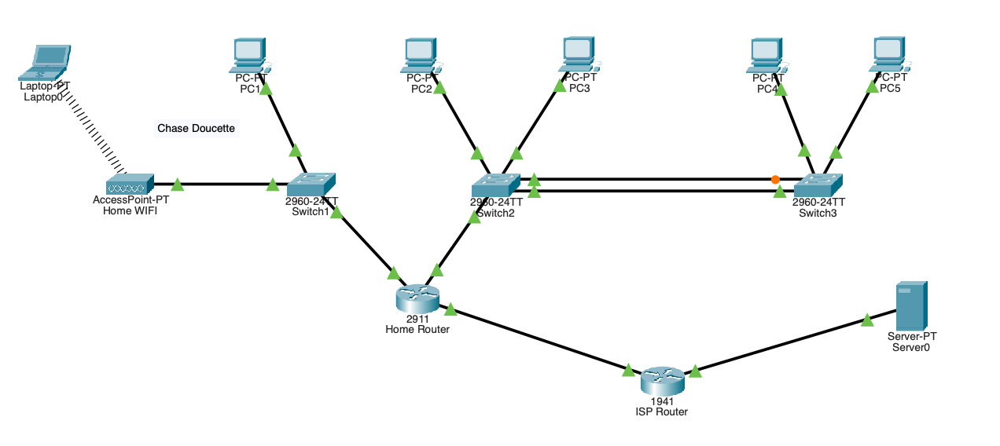
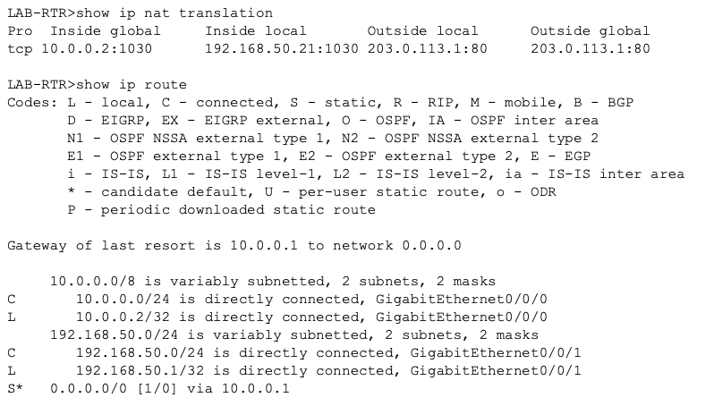

# Enterprise Network Build in Cisco Packet Tracer

Started **September 2026**. Built in phases from a basic home network toward a multi-site enterprise design, aligned with **CompTIA Network+ (N10-009)** and **Cisco CCNA (200-301)**.

## Topology
<!-- TODO: export the topology from Packet Tracer and save it here -->


## Phase status
| Phase | Topic | Status |
|---|---|---|
| 0 | Home / SOHO network: DHCP, NAT/PAT, wireless | ✅ Done |
| 1–3 | Small-business LAN: VLANs, trunking, inter-VLAN routing, STP, port security, ACLs | ✅ Done |
| 4 | Static, OSPF, and EIGRP routing | ⏳ Next |
| 5 | WAN links and DHCP relay | Planned |
| 6 | HSRP and EtherChannel | Planned |
| 7 | Device hardening | Planned |

---

## Phase 0: Home / SOHO network
**Goal:** a working home network with automatic addressing, internet access through NAT, and a wireless client.

**Built:**
- Cisco 2911 edge router with a DHCP pool
- NAT/PAT overload to a simulated ISP
- Wireless access point serving a laptop client

**Key commands:**
```
! TODO: paste your real config, e.g.
! ip dhcp pool HOME
! ip nat inside source list 1 interface g0/1 overload
```

**Verified with:** `show ip nat translations`


---

## Phases 1–3: Small-business LAN
**Goal:** segment departments, extend them across switches, route between them, and lock the network down.

| Feature | What I did | How I verified it |
|---|---|---|
| VLANs | Separate VLANs for Sales and Engineering | Hosts in different VLANs could not reach each other before routing |
| 802.1Q trunking | Extended both VLANs across two switches | `show interfaces trunk` |
| Inter-VLAN routing | Router-on-a-stick with dot1Q sub-interfaces | Pings in both directions |
| STP | Added a redundant switch link | `show spanning-tree`: root bridge elected, one port `Altn/BLK` |
| Port security | Sticky MAC, max 1, shutdown on violation | Triggered a live violation, recovered the err-disabled port |
| Extended ACL | Blocked Engineering → Sales, permitted everything else | `show access-lists` match counters |

**Key commands:**
```
! TODO: paste your real configs for the sub-interfaces, port security, and ACL
```

**Screenshots:**


## Problems I hit and how I fixed them
| Problem | Cause | Fix |
|---|---|---|
| <!-- TODO: e.g. inter-VLAN ping failed --> | <!-- e.g. trunk not allowing VLAN 20 --> | <!-- e.g. switchport trunk allowed vlan add 20 --> |

## Troubleshooting approach
`show` commands, Simulation mode packet inspection, and ACL counters to find root causes.
