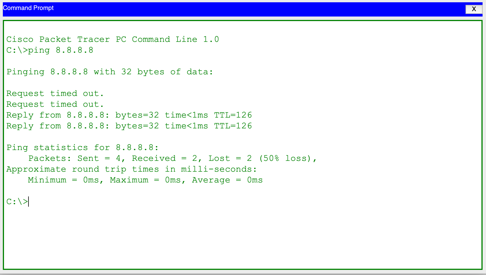
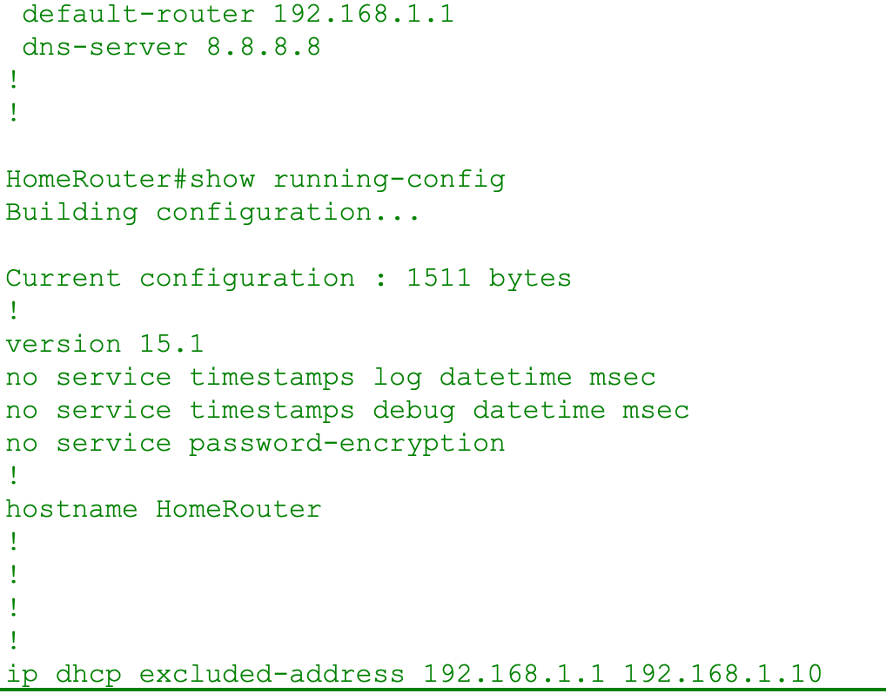
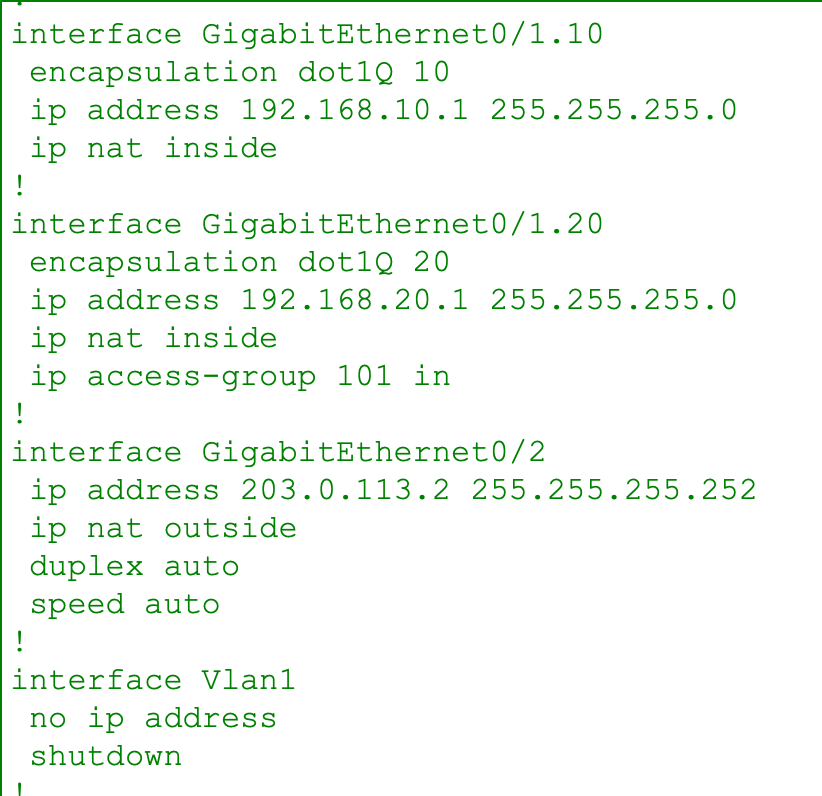

# Enterprise Network Build in Cisco Packet Tracer

Started **September 2026**. I'm building this in phases, from a basic home network up to a multi-site enterprise design. The phases follow **CompTIA Network+ (N10-009)** and **Cisco CCNA (200-301)**.

Each phase ends with a working `.pkt` file. I verify each one with `show` commands and test traffic.

## Topology


```
Laptop0 ~~wireless~~ Home WIFI (AP) ── Switch1 ── PC1
                                         │
                                   HomeRouter (Cisco 2911) ── ISP Router (Cisco 1941) ── Server0 (8.8.8.8)
                                         │ Gig0/1 (802.1Q trunk)
                                      Switch2 ── PC2 (VLAN 10), PC3 (VLAN 20)
                                       ║  ║   (redundant links, one blocked by STP)
                                      Switch3 ── PC4 (VLAN 10), PC5 (VLAN 20)
```

## Phase status
| Phase | Topic | Status |
|---|---|---|
| 0–2 | Home lab and SOHO: DHCP, NAT/PAT, wireless, simulated ISP | ✅ Done |
| 3 | Small-business LAN: VLANs, trunking, inter-VLAN routing, STP, port security, ACLs | ✅ Done |
| 4 | Routing: static, floating static, OSPF, EIGRP | ⏳ Next |
| 5 | WAN and network services: serial links, DHCP relay, DNS/web servers | Planned |
| 6 | Enterprise: HSRP, EtherChannel, STP tuning, segmentation, hardening | Planned |
| 7 | Stretch: SNMP/syslog, IPv6 dual-stack | Planned |

## IP addressing
| Network | Subnet | Gateway | Purpose |
|---|---|---|---|
| Home LAN | 192.168.1.0/24 | 192.168.1.1 | PC1, Laptop0 (DHCP; .1–.10 excluded) |
| VLAN 10 SALES | 192.168.10.0/24 | 192.168.10.1 | PC2 .10, PC4 .12 |
| VLAN 20 ENGINEERING | 192.168.20.0/24 | 192.168.20.1 | PC3 .11, PC5 .13 |
| WAN link | 203.0.113.0/30 | n/a | HomeRouter .2 ↔ ISP .1 |
| "Internet" | 8.8.8.0/24 | 8.8.8.1 | Server0 8.8.8.8 |

---

## Phases 0–2: Home lab and SOHO
**Goal:** a working home network with automatic addressing, a wireless client, and internet access through NAT.

**Built:**
- Cisco 2911 edge router running a DHCP pool for the home LAN.
- NAT/PAT overload out to a simulated ISP router (Cisco 1941). Behind the ISP router is a server standing in for the internet (8.8.8.8).
- WPA2-PSK/AES access point serving a laptop. The laptop gets its address by DHCP over wireless.

**Key config (HomeRouter):**
```
ip dhcp excluded-address 192.168.1.1 192.168.1.10
ip dhcp pool LAN-POOL
 network 192.168.1.0 255.255.255.0
 default-router 192.168.1.1
 dns-server 8.8.8.8
!
interface GigabitEthernet0/0
 ip address 192.168.1.1 255.255.255.0
 ip nat inside
interface GigabitEthernet0/2
 ip address 203.0.113.2 255.255.255.252
 ip nat outside
!
ip route 0.0.0.0 0.0.0.0 203.0.113.1
access-list 1 permit 192.168.1.0 0.0.0.255
access-list 1 permit 192.168.10.0 0.0.0.255
access-list 1 permit 192.168.20.0 0.0.0.255
ip nat inside source list 1 interface GigabitEthernet0/2 overload
```

**Verified with:**

`show ip nat translations` shows private inside addresses translated to the public WAN address 203.0.113.2:


---

## Phase 3: Small-business LAN
**Goal:** separate the departments onto their own networks, stretch those networks across two switches, route between them, and lock the network down.

| Feature | What I did | How I verified it |
|---|---|---|
| VLANs | VLAN 10 SALES and VLAN 20 ENGINEERING | `show vlan brief`; hosts in different VLANs couldn't reach each other before routing |
| 802.1Q trunking | Both VLANs extended across Switch2 and Switch3; every trunk hard-set to `on` | `show interfaces trunk`, `show cdp neighbors` |
| Inter-VLAN routing | Router-on-a-stick using dot1Q sub-interfaces | Pings in both directions |
| STP | Redundant Switch2↔Switch3 link | `show spanning-tree`: Switch2 elected root, Switch3's 100M port in `Altn/BLK` |
| Port security | Sticky MAC, maximum 1, shutdown on violation | Triggered a live violation, then recovered the err-disabled port |
| Extended ACL | Blocked Engineering → Sales, permitted everything else | `show access-lists` match counters, plus "Destination host unreachable" returned by the router |

**Key config: inter-VLAN routing and ACL (HomeRouter):**
```
interface GigabitEthernet0/1
 no ip address
 no shutdown
interface GigabitEthernet0/1.10
 encapsulation dot1Q 10
 ip address 192.168.10.1 255.255.255.0
 ip nat inside
interface GigabitEthernet0/1.20
 encapsulation dot1Q 20
 ip address 192.168.20.1 255.255.255.0
 ip nat inside
 ip access-group 101 in
!
access-list 101 deny ip 192.168.20.0 0.0.0.255 192.168.10.0 0.0.0.255
access-list 101 permit ip any any
```

**Key config: VLANs, trunks, and port security (Switch2):**
```
vlan 10
 name SALES
vlan 20
 name ENGINEERING
!
interface FastEthernet0/1
 switchport mode trunk
interface FastEthernet0/4
 switchport mode trunk
interface GigabitEthernet0/1
 switchport mode trunk
!
interface FastEthernet0/2
 switchport mode access
 switchport access vlan 10
 switchport port-security
 switchport port-security maximum 1
 switchport port-security violation shutdown
 switchport port-security mac-address sticky
interface FastEthernet0/3
 switchport mode access
 switchport access vlan 20
```

**Verified results:**
- `show access-lists`: ACL 101 deny = 4 matches and permit = 4 matches. ACL 1 (NAT) shows matches from all three LANs.
- PC3 → PC2 ping gets "Destination host unreachable" from 192.168.20.1. The router itself rejects it, which proves the ACL is doing the blocking.
- `show spanning-tree` on Switch3: the 1G port is Root/FWD and the 100M port is Altn/BLK.
- Port security on Fa0/2: Secure-up, sticky MAC learned, 0 violations.

---

## Change log: cleanup pass (Oct 20, 2026)
| Change | Why |
|---|---|
| Extended NAT ACL 1 to cover VLANs 10 and 20 | Phase 3 hosts had no internet access. Verified with PC2 and PC3 pinging 8.8.8.8 4/4 |
| Removed an empty `router rip` | Unused leftover config |
| Set hostnames on HomeRouter, Switch2, Switch3 | Readable prompts and CDP output |
| `no ip domain-lookup` | A mistyped command was hanging on a DNS lookup |
| Hard-set Switch2 Fa0/4 to `switchport mode trunk` | It was trunking through DTP auto-negotiation; set explicitly so it's predictable |

After the NAT fix, a VLAN host reaches the "internet" (8.8.8.8). The first two timeouts are ARP resolving on first contact:


HomeRouter running config after the cleanup (1511 bytes). The sub-interfaces now have `ip nat inside`:



---

## Problems I hit and how I fixed them
| Problem | Cause | Fix / lesson |
|---|---|---|
| Cross-switch ping failed after trunking, which looked like a trunk fault | PC2's own IP configuration was wrong | Check host IP settings first. Simulation mode's PDU inspector shows the exact drop reason |
| VLAN hosts couldn't reach the internet | NAT ACL 1 only permitted 192.168.1.0/24 | Added permit lines for 192.168.10.0/24 and 192.168.20.0/24 |
| Console froze after a typo | IOS treats an unknown word as a hostname and tries DNS | `no ip domain-lookup`; Ctrl+Shift+6 cancels a lookup in progress |
| Sticky MAC never got learned | No traffic had come from the PC yet | Generate traffic (a ping) so the switch learns the MAC |
| Port stayed down after a security violation | `violation shutdown` puts the port in err-disabled, which doesn't clear on its own | `shutdown` then `no shutdown` on the interface |
| First pings time out | ARP resolution on first contact | Expected behavior, not a fault |
| Any deny-only ACL would block everything | Every ACL ends with an implicit deny-all | Always add an explicit `permit ip any any` after the deny |

## Known gaps (scheduled for Phase 6 hardening)
Lab-only defaults are still in place: no enable secret, no VTY passwords or SSH, password encryption off, unused ports not shut down, native VLAN still 1, and the STP root was won by lowest MAC instead of being set on purpose. These get fixed in Phase 6.

## Troubleshooting approach
I use `show` commands, Simulation-mode packet inspection, and ACL match counters to confirm the root cause instead of guessing.
